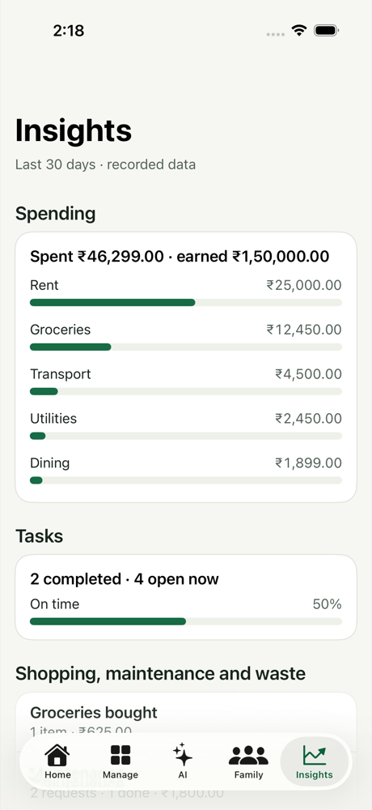
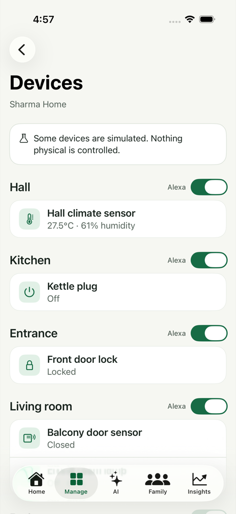
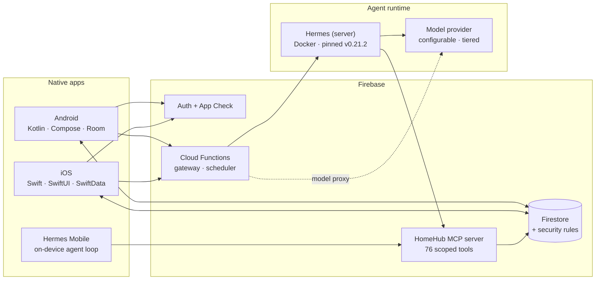

<div align="center">


# HomeHub AI

### Your Agentic Household Manager

Tasks, groceries, bills, meals, maintenance and family — run by an assistant that **does the work**
and **asks before it spends, books or sends**.

<br/>


<br/>

&nbsp;
&nbsp;
&nbsp;


<sub>The iOS app with a demo household. Android is built to match it screen for screen.</sub>

</div>

<br/>

---

## Why it exists

Running a home is a hundred small decisions — what's low in the pantry, which bill is due, who's doing the
bins, whether the milkman came. HomeHub keeps all of it in one place and puts an assistant on top that can
actually *act*: add the groceries, plan the week, record that the milk wasn't delivered on the 3rd, set a
reminder — while **purchases, payments, bookings, external messages and deletions always wait for a person's approval.**

> *"Ramesh the milk vendor didn't come on the 3rd and 4th, and then he was away from the 9th till the 11th.
> Also on the 14th we got 2 liters."*
> → the month's bill is recalculated, to the paisa, from what was actually delivered.

## ✨ Highlights

<table>
<tr>
<td width="33%" valign="top">

### 🤝 An assistant you can trust
It plans the week, builds the grocery list and watches the budget — but **every purchase, payment, booking, message or deletion waits for your approval**, enforced on the server, not just in the UI. Every action is audited and checked against the real data before it says "done".

</td>
<td width="33%" valign="top">

### 🥛 Bills that match reality
Pay-per-delivery bills for **milk, newspaper, maid, water cans, tiffin**. Tell it *"Ramesh didn't come on the 3rd and 4th"* — the month's total is recalculated to the paisa from what was actually delivered.

</td>
<td width="33%" valign="top">

### 🪟 Liquid Glass, truly native
The same translucent, softly-lit design on **iOS and Android**, each built natively — real backdrop blur, accessible fallbacks, glass only where it helps. No Flutter, no WebViews.

</td>
</tr>
<tr>
<td valign="top">

### 📱 The agent runs on your phone
**Hermes Mobile** is an on-device agent loop, so everyday requests don't need a server round-trip. A server Hermes handles scheduled work — and the app keeps working even when the assistant doesn't.

</td>
<td valign="top">

### 🔌 Offline-first, conflict-safe
Add and complete tasks, edit lists and notes with no signal. Changes sync with retries and idempotent writes, and **financial records are never silently overwritten**.

</td>
<td valign="top">

### 🧾 Spending that captures itself
UPI and bank alerts on Android, and Shortcuts on iOS, become expense suggestions you review — with de-duplication, so nothing is counted twice.

</td>
</tr>
<tr>
<td valign="top">

### 🏠 One home, many devices
Lights, plugs, AC and locks by room, with **read-back verification**. Home Assistant bridge, **Alexa** account linking, Telegram, read-only Google Calendar — and a plugin SDK for more.

</td>
<td valign="top">

### 🔐 Privacy by design
Roles for owner, admin, adult, child and staff; staff see only assigned work. Private notes stay private, deny-by-default security rules, and data export and deletion built in.

</td>
<td valign="top">

### 💸 Token-frugal by design
A deterministic router picks the skill and model tier, context stays compact, and **no LLM is used for arithmetic, dates or plain CRUD**. A usage ledger measures cost per workflow.

</td>
</tr>
</table>

## What you get

<table>
<tr>
<td width="50%" valign="top">

**🏠 Run the house**
- **Tasks** — assign, recur, checklist, comment
- **Cleaning** — room-wise routines, deep cleans
- **Shopping** — multiple lists, price estimates
- **Pantry** — stock, expiry, waste, **bulk paste-in**
- **Meals** — weekly plan, recipes, one-tap grocery list
- **Calendar** — events, conflicts, reminders
- **Maintenance & assets** — warranties, service dates
- **Notes & documents** — private or shared, restricted records

</td>
<td width="50%" valign="top">

**💰 Know the money**
- **Finance** — income, expenses, budgets, savings goals
- **Bills** — fixed *or* **pay-per-delivery** (milk, newspaper, maid, tiffin) with a month ledger
- **Automatic spending capture** — Android notifications, iOS Shortcuts
- **Reports** — spending, budgets, tasks, wastage, agent usage
- Exact arithmetic: **integer minor units, never floats**
- HomeHub **never moves money**

</td>
</tr>
<tr>
<td width="50%" valign="top">

**🤖 An assistant that earns trust**
- Plans the week, prepares for guests, watches the budget
- **76 narrowly-scoped tools**, no shell, no raw database
- **Approvals** for anything that spends, books, sends or deletes
- **Four autonomy modes** + an emergency pause
- Every action **audited and verified** against the data
- Works **on the phone** (Hermes Mobile) and on a server

</td>
<td width="50%" valign="top">

**🔌 Connected home**
- **Devices** — lights, plugs, AC, locks (read-back verified)
- **Automations** — when this happens, do that
- **Home Assistant** bridge · **Alexa** (OAuth + PKCE)
- **Telegram** bot · **Google Calendar** (read-only)
- **Plugin SDK** with manifests, scopes and a certification checklist
- **Roles** — owner, admin, adult, child, staff

</td>
</tr>
</table>

## Liquid Glass, on both platforms

A single visual language — translucent, layered, softly lit — implemented **natively** each way:

| | iOS | Android |
|---|---|---|
| **Material** | Apple's native Liquid Glass (`glassEffect`, system tab bar) on iOS 26+ | Real backdrop blur via `RenderEffect` (API 31+), tinted translucent fallback below |
| **Accessibility** | Reduce Transparency → solid surfaces | High-contrast → solid surfaces |
| **Restraint** | Glass on floating nav, composer, toolbars and sheets — **never** on dense lists, forms or documents | same |
| **Tokens** | Emerald `#176B45` · Sage `#A8BFA7` · Ivory `#F6F7F2` · Charcoal `#18231D` · Gold `#D6A344` · Terracotta `#B9674E` | same |

No Flutter, no React Native, no WebViews. Two native apps, one brand, one set of contracts.

---

## How it fits together



- **Apps never talk to the agent directly.** They go through the gateway, which checks the Firebase token, household membership, role, action scope, autonomy policy and approval state.
- **Tools never accept a household id.** The household comes from a per-run, server-minted grant, so cross-household access is impossible by construction.
- **Hermes is the runtime, not the database.** Firestore is the source of truth; the assistant reads and writes through tools.
- **The apps keep working without the assistant.** Every ordinary feature is deterministic and offline-first.

### Safe by design

| Principle | How |
|---|---|
| **Approval, enforced on the server** | Purchases, payments, bookings, external messages, sharing and deletions become approval requests — a model can't skip them, and the UI isn't the only gate |
| **Least privilege** | Firestore + Storage rules deny by default; roles enforced in rules *and* functions; staff see only assigned work |
| **Untrusted input stays untrusted** | Documents, messages and calendar text are data and can't change tools, permissions or policy |
| **Verified, not claimed** | Device changes are read back; writes are re-checked in Firestore before the assistant says "done" |
| **Privacy** | Private notes and memory stay private; export and delete flows; secrets only in Secret Manager |
| **Money** | Integer minor units end to end; reconciled records are locked; conflicts are surfaced, never silently overwritten |

### Token-efficient on purpose

Deterministic router picks the skill and model tier · compact household context, never the whole database · skills load on demand ·
no LLM for arithmetic, dates or CRUD · bounded retries and per-workflow budgets · a usage ledger records tokens, cost and
success per workflow — so savings are *measured*, not claimed.

---

## Repository map

```
android/            Kotlin + Compose app (com.e404.homehub) — Room outbox, WorkManager, Hermes Mobile
ios/                SwiftUI app (com.e404.homehub) — SwiftData outbox, BGTasks, Hermes Mobile · XcodeGen
backend/firebase/   Firestore + Storage rules, indexes, Cloud Functions (gateway, MCP, scheduler, plugins)
agents/hermes/      Orchestrator profile, SOUL.md, 8 on-demand skills, Docker stack
shared/schemas/     JSON Schemas generated from the server's zod contracts
docs/               Architecture, security, setup, plugin SDK, certification, design system
scripts/            quickstart, setup wizard, doctor, Android/iOS run scripts, deploy, Hermes-in-Docker
tests/evidence/     Screenshots captured from emulators and simulators
```

<details>
<summary><b>The eight skills</b></summary>

`household-manager` · `finance-manager` · `smart-shopping` · `meal-planner` · `home-maintenance` ·
`family-coordinator` · `household-reports` · `approval-manager` — each a `SKILL.md` with purpose, activation
criteria, allowed tools, prohibited actions, workflow, output format, verification and error handling.
A test fails if a skill names a tool that doesn't exist or any tool is unreachable from every skill.
</details>

<details>
<summary><b>Assistant tools, by area</b></summary>

| Area | Tools |
|---|---|
| Household | `get_household_summary` · `get_household_members` · `get_member_permissions` · `list_memories` · `remember_preference` · `forget_memory` |
| Tasks | `list_tasks` · `create_task` · `update_task` · `complete_task` · `assign_task` · `list_task_comments` · `add_task_comment` |
| Shopping & pantry | `list_shopping_lists` · `get_shopping_list` · `create_shopping_list` · `add_shopping_item` · `update_shopping_item` · `remove_shopping_item` · `mark_item_purchased` · `get_inventory` · `get_low_stock_items` · `add_pantry_items` · `adjust_pantry` |
| Meals | `get_meal_plan` · `create_meal_plan` · `generate_meal_shopping_list` · `list_recipes` · `create_recipe` |
| Money | `get_budget_summary` · `list_expenses` · `record_expense` · `record_income` · `set_budget` · `list_savings_goals` · `create_savings_goal` · `add_to_savings_goal` |
| Bills | `get_bill_status` · `list_bills` · `create_bill` · `update_bill` · `create_vendor_bill` · `update_vendor_bill` · `record_deliveries` · `get_bill_ledger` · `record_bill_payment`* |
| Home | `list_maintenance_records` · `create_maintenance_request` · `schedule_service_reminder` · `list_assets` · `create_asset` · `list_cleaning` · `create_cleaning_routine` · `mark_cleaned` · `list_notes` · `create_note` · `list_documents` |
| Calendar | `list_events` · `create_event` · `update_event` · `cancel_event` · `check_schedule_conflicts` |
| Devices & services | `list_devices` · `control_device` · `list_automations` · `set_automation_enabled` · `create_automation`* · `list_integrations` · `call_integration_tool` |
| People | `invite_member`* · `change_member_role`* |
| Approvals & reports | `request_approval` · `list_pending_approvals` · `get_approval_status` · `get_household_report` · `get_agent_usage_report` |

<sub>* always held for a person's approval; the action runs as the approving person.</sub>
</details>

---

## Quick start

```bash
git clone https://github.com/iamsanaur/home-hub.git && cd home-hub

scripts/quickstart.sh            # try it locally: no accounts, no keys, no cost
scripts/build-android.sh run     # …on an Android emulator
scripts/run-ios.sh               # …or in the iPhone simulator (Mac)

scripts/setup.sh                 # run it for real on your own Firebase project (guided, re-runnable)
```

`scripts/doctor.sh` tells you what to install if anything is missing. The full walk-through — what each step does,
what it costs, and troubleshooting — is in [`docs/getting-started.md`](docs/getting-started.md).

> **Bring your own Firebase.** `google-services.json`, `GoogleService-Info.plist`, release keys and `.env` files are
> deliberately **not** in this repo; `scripts/setup.sh` creates them for your project.

### Tests

```bash
cd backend/firebase/functions
npx vitest run test/unit            # 83 unit tests
npm run test:emulator               # 124 rules + integration tests on the emulators
cd android && ./gradlew :app:testDebugUnitTest
cd ios && xcodebuild test -scheme HomeHub -destination 'platform=iOS Simulator,name=iPhone 17'
```

Cross-household isolation, role limits, approval gating, idempotency, offline sync policy, the milk-vendor maths and
every assistant tool have automated tests.

---

## Docs

[Getting started](docs/getting-started.md) · [Architecture](docs/architecture.md) · [Security](docs/security.md) · [Firebase setup](docs/firebase-setup.md) ·
[Hermes setup](docs/hermes-setup.md) · [Deployment](docs/deployment.md) · [Alexa](docs/alexa.md) ·
[Plugin SDK](docs/plugin-sdk.md) · [Plugin certification](docs/plugin-certification.md) ·
[Design tokens](docs/design-tokens.md) · [Accessibility checklist](docs/accessibility-checklist.md)

## Licence

No open-source licence has been granted yet, so all rights are reserved by default. Open an issue if you'd like to use or
contribute to HomeHub.

<div align="center">
<br/>

**HomeHub AI** · built with care for the people who actually run the home

</div>
